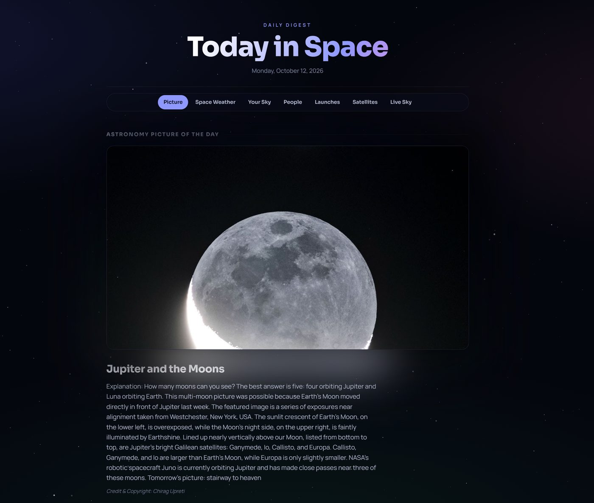
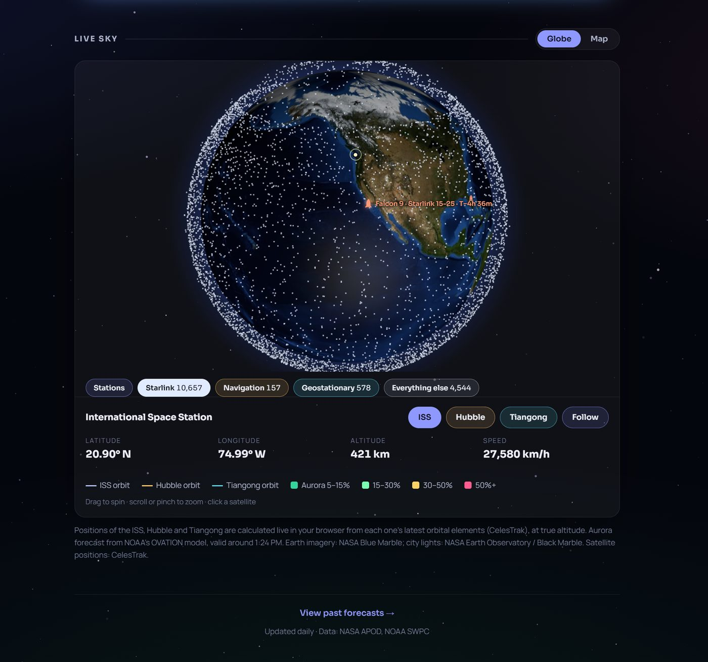
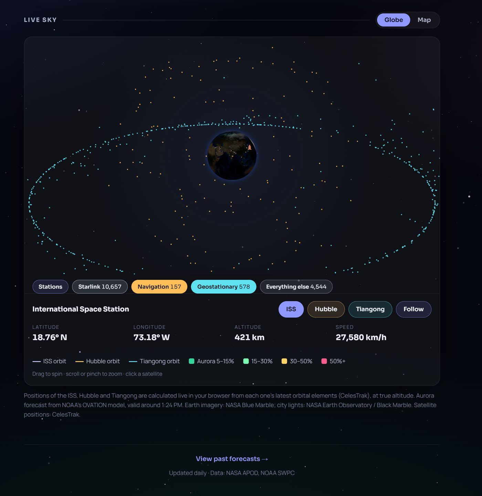
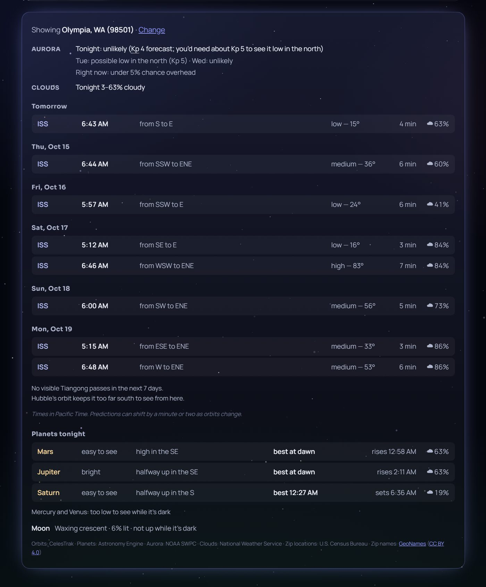
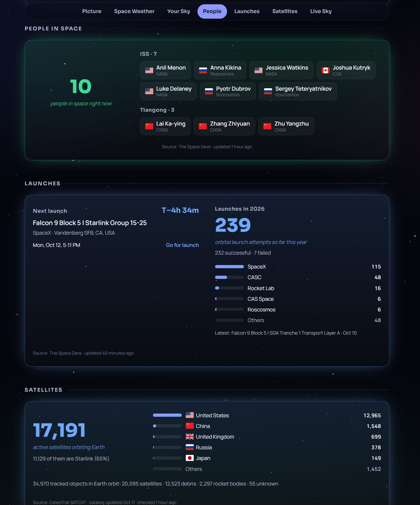
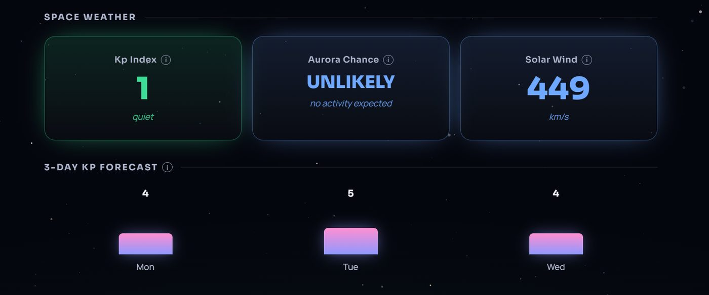
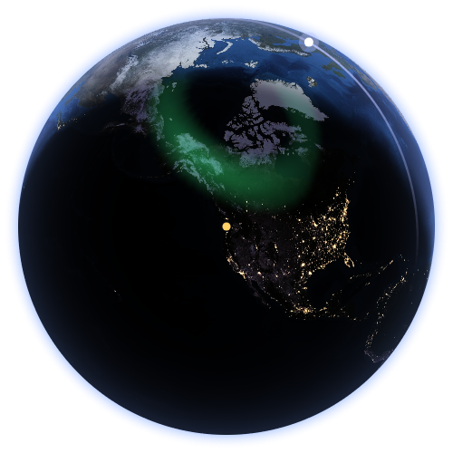
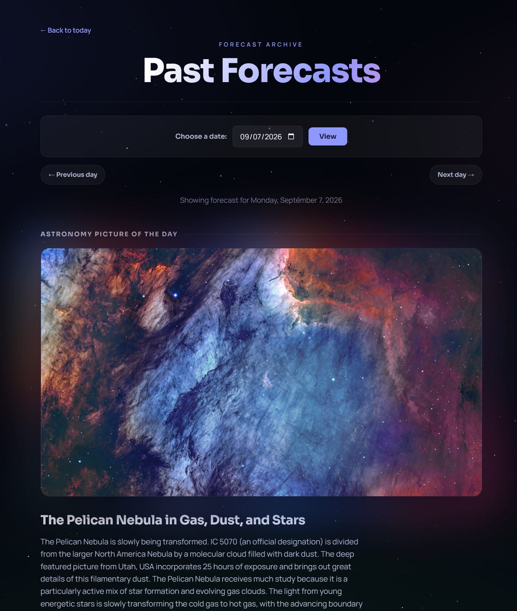

# Today in Space

### [Open the live site →](https://space.evergreensystemswa.com/)

Everything worth looking up at tonight, for where you are. A web app I built that tracks the International Space Station and every active satellite in real time, tells you when you can see them from your zip code, and keeps an eye on space weather, launches and the people in orbit and NASA's Astronomy Picture of the Day.



## Live Sky: a real-time 3D globe



- The ISS, Hubble and China's Tiangong station move along their real orbits, computed live in your browser from each one's latest orbital elements with SGP4 (the standard model satellite trackers use).
- Turn on **all ~16,000 active satellites**: the Starlink shell, the GPS/navigation satellites 20,000 km up, and the geostationary ring at 36,000 km. They're drawn as one GPU point cloud and propagated in a Web Worker, so the page stays smooth.
- City lights glow on the night side, the aurora oval glows over the poles from NOAA's forecast, and upcoming launch pads show a countdown.
- Your location, your next visible ISS pass, and the circle of Earth that can see the ISS right now.
- Full-screen mode, a flat map view, and a live readout of latitude, longitude, altitude and speed.



## Your sky this week

Enter a zip code (or use your location) and get the ISS and Tiangong passes you can actually see over the next 7 days — when, which direction, how high, and how cloudy it'll be — plus the planets and Moon tonight and your odds of seeing the aurora from your latitude.



## People, launches and satellites

Who's in space right now and on which station, the next launch with a live countdown, every orbital launch attempt this year by provider, and how many satellites are up there and whose they are.



## Space weather, explained

The Kp index, aurora chance, solar wind and NOAA's 3-day forecast — each with a plain-English explanation, because most people don't know what a Kp index is.



## A live picture of Earth

The server draws an image of Earth right now — day and night, city lights, the aurora and the ISS — centered on any location. It powers an iPhone home-screen widget and the site's link previews.



## Every day is saved

The daily picture and space weather are archived, so you can go back to any past day.



## How it works

- **Azure Functions** on timers do all the fetching, so the website never waits on (or overloads) another service: the daily digest from NASA and NOAA twice a day, people in space every 3 hours and launches every hour from The Space Devs, and satellite data from CelesTrak every 6 hours (only downloading it when it has changed). Results are saved to **Azure Blob Storage**.
- The website is **ASP.NET Core MVC on .NET 10**, hosted on **Azure App Service (Linux)**. Every feature has its own JSON API (`/api/sky/...`), so a mobile app can use the same data later.
- **Orbit math** runs in two places: in the browser (satellite.js) for the live globe, and on the server (SGP.NET) for visible-pass predictions. The SGP4 implementation is checked against Vallado's published reference vectors. The Sun, Moon and planets come from Astronomy Engine.
- The **Earth image** is rendered on the server with SkiaSharp (an orthographic projection of NASA's Blue Marble and Black Marble imagery).
- **Privacy:** your location is rounded to about 1 km in the browser before it's sent, rounded again on the server, and never logged. Location lookups are rate-limited.
- `/healthz` reports whether the site can read storage and whether the daily update ran on time.
- **GitHub Actions** builds, runs 340+ automated tests (xUnit), and deploys on every merge to `main`. Infrastructure is defined in Bicep (`infra/`). It runs for about $13 a month.

**Built with:** C#, .NET 10, ASP.NET Core MVC, Azure App Service, Azure Functions, Azure Blob Storage, JavaScript, globe.gl / three.js, satellite.js, SGP.NET, Astronomy Engine, SkiaSharp, xUnit, GitHub Actions, Bicep

## How I built it

I am the sole developer and maintainer of Today in Space. I designed, built, deployed, and have maintained the application since March.

I use AI-assisted workflows to help with planning, implementation, and debugging. I make the technical decisions, review changes, and maintain the deployed application. AI contributions are documented through co-author attribution in the commit history.

## Background

This started as my class project for CS 350 at SPSCC: a timer-triggered Azure Function making API calls for astronomy and space-weather data.

Since then, I have grown it into a public application. I removed the sign-up wall, added stored copies of images to protect the archive from broken upstream links, moved hosting to my company's Azure account and domain, and built the live globe, satellite tracking, launch information, and location-based sky views.

## Running it yourself

You'll need the .NET 10 SDK (and Azure Functions Core Tools to run the functions locally).

```bash
cd src/TodayInSpace.Web
dotnet user-secrets set "Storage:ConnectionString" "<your Azure Storage connection string>"
dotnet user-secrets set "Map:CartoKey" "<your CARTO basemap key>"
dotnet run
```

The CARTO key is free from [carto.com/basemaps/apikey](https://carto.com/basemaps/apikey). Without it the flat map still works, just without the dark basemap underneath.

Run the tests with `dotnet test TodayInSpace.slnx`.

---

Data from [NASA APOD](https://api.nasa.gov/), [NOAA Space Weather Prediction Center](https://www.swpc.noaa.gov/), [CelesTrak](https://celestrak.org/), [The Space Devs](https://thespacedevs.com/), the [National Weather Service](https://www.weather.gov/), the [U.S. Census Bureau](https://www.census.gov/) and [GeoNames](https://www.geonames.org/) ([CC BY 4.0](https://creativecommons.org/licenses/by/4.0/)). Map tiles © OpenStreetMap contributors © CARTO. Earth imagery: NASA Blue Marble; city lights: NASA Earth Observatory / Black Marble.
